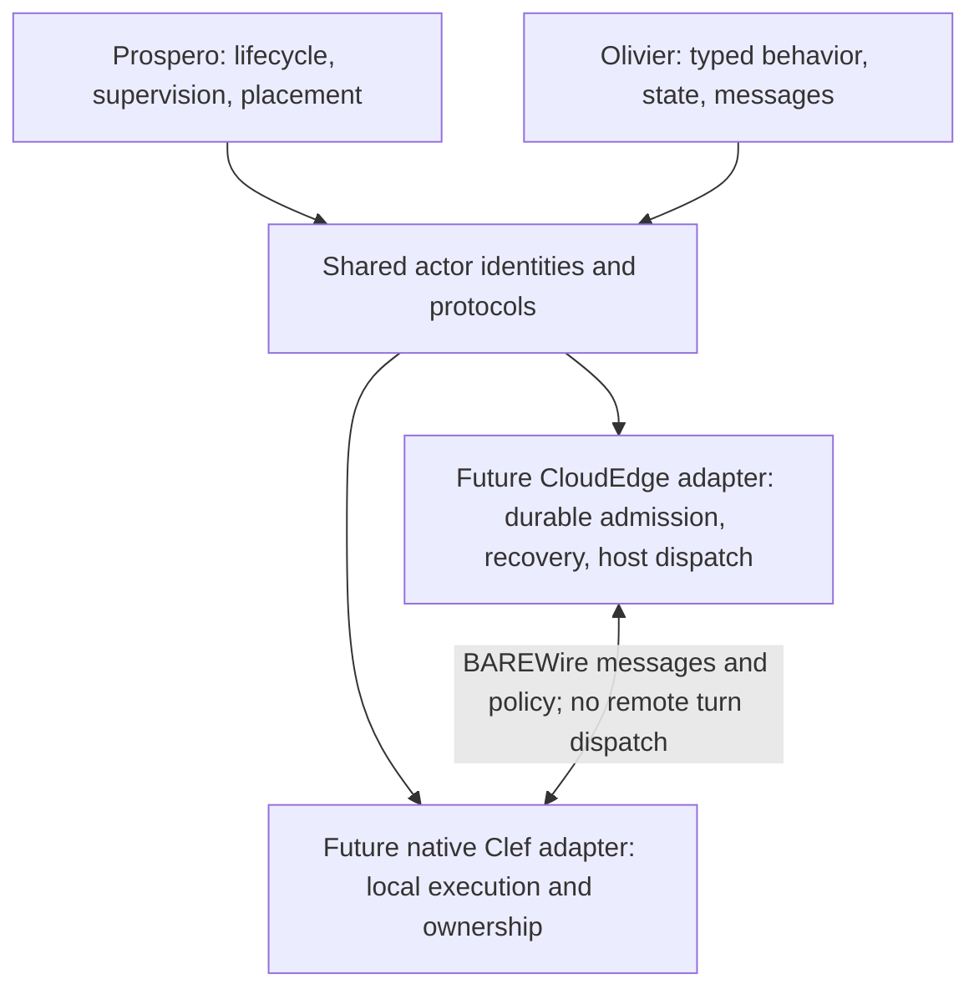

# Architecture and initial scope

`Fidelity.CloudEdge.Actor` is intended to present Clef-shaped actor semantics on a
CloudEdge host. The current project contains portable F# declarations only. Its
version is `0.0.1-scaffold.1`; the API is provisional and packaging is disabled.
The existing Fidelity.FSharp.Incremental checkpoint remains unchanged.

## Boundaries

The graph describes future responsibility boundaries, not implemented components.
Xantham-generated bindings provide platform interoperability facts. Handwritten
adapters must implement and validate the actor contract over those facilities.
The Cloudflare Actors SDK does not define this library's lifecycle or topology.

A future adapter may use Incremental's deterministic dependency/demand rules for
work that needs incremental recomputation. It must not import Incremental.Hosting
into JavaScript, equate each graph node with an actor, or duplicate compiler proof
authority. Actor and incremental identities inhabit distinct scopes; an explicit
mapping would be required. There is no Incremental dependency in this scaffold.

## Present vocabulary

| Source | Declared concepts | Limit |
| --- | --- | --- |
| [Identity.fs](../src/Fidelity.CloudEdge.Actor/Identity.fs) | Logical identity, incarnation, schema/artifact identities, roles and intended host class | Data is not an authenticated reference or provider capability. |
| [Lifecycle.fs](../src/Fidelity.CloudEdge.Actor/Lifecycle.fs) | Activation/lifecycle, connections, reachability, reports and topology | Observations do not create relationships or authorize execution. |
| [Protocol.fs](../src/Fidelity.CloudEdge.Actor/Protocol.fs) | Typed envelopes, admission/results, checkpoints and child specifications | No decoder, durable store, transition engine, recovery or spawn function exists. |

The separation is deliberate: the connection can be live while the actor is
`Dormant`; an unreachable actor is not necessarily `Terminated`; a `Stopping`
actor may still own work. Logical routing identity can survive a crash restart,
while a previous incarnation's references must not regain authority implicitly.
The adapter's ability to distinguish hydration from crash restart remains open.

Records/unions remain typed, with generic message, reply, state and configuration
payloads. There is no object-backed payload store, semantic reflection or closure
serialization. A future schema validator still has to reject nonportable captures
and invalid field values; a generic type alone cannot enforce serializability.
The declarations are not the BAREWire schema. Preserve full-width incarnation and
sequence values through explicit codecs; do not convert uint64 identities to JS
numbers or equate the existing u32 envelope correlation with actor identity.

## Durable inbox and the current Incremental lessons

A durable inbox service precedes an activation. Supported hibernating connections
provide reachability without resident actor execution. The future admission
transaction binds request identity, validated payload, incarnation and capacity
reservation before acknowledging acceptance. Data remains in the receiver's inbox;
a supervisory hydration notification is control traffic, not another message queue.

Admission, result production, application of a result and physical cleanup are
separate facts. A reply observer may detach without retracting accepted work.
After a disconnect, retry or reset, exact-request reconciliation must not admit a
second operation or revive a superseded incarnation. Receipt retention/expiry is
part of the protocol, including how an old receipt can be read without authorizing
old-incarnation execution.

Pure state transitions should produce explicit effects; the owner commits state
and then interprets effects with declared ordering. Remote effects require durable
intent and destination-side idempotency/reconciliation. A transaction local to one
Durable Object cannot certify exactly-once external execution. Invalidated results
must be rejected independently of whether the old worker has actually stopped.

One-shot resumption requires a matching operation/attempt, valid code and schema,
current state/input premises and exclusive ownership of the actor turn. A stored
`Checkpoint<'State>` names typed recovery data, not a captured Async continuation
or a complete Incremental.Core persistence format. Ephemeral resources need rebinding
or explicit refusal. Compiler settlement of captures and lifetimes remains compiler work.

## Parent APIs, supervision and topology

`ChildSpecification<'Configuration>` reserves vocabulary for an explicit creation
request, parent, proposed child identity, role, placement class and artifact.
It deliberately supplies no executable `spawn` stub. Future parent operations need
separate admission, provisioning, readiness, retirement and cleanup outcomes.
An accepted spawn is not a ready worker, and a stopped connection is not a drained child.

Supervision ancestry, peer routing and job membership are distinct relationships.
Reports need an authenticated reporter, incarnation, ordering and topology context;
unknown/stale observations cannot authorize a restart or revive a retired result.
The current topology describes parent/supervision/routing only. Job membership,
closure rules, supervision policies and causal history remain future contracts.

Dynamic Worker isolates, durable facets, containers and external native workers
have different placement/lifetime capabilities. A provider must refuse unsupported
requirements before launching work. Child code provenance, bindings/capabilities,
resource budgets, restart intensity, escalation and migration policy remain explicit
Prospero concerns. Arbitrary code execution is not enabled by this repository.

## Draft host assumption register

No row below is discharged by this scaffold. A future implementation must publish
a concrete manifest against the pinned scheduler contract.

| Concern | Required adapter/host accounting |
| --- | --- |
| Turns and resumption | Serialize actor state transitions and declare reentrancy across awaits. |
| Progress and fairness | Name host assumptions; do not infer a finite dispatch bound from single-threaded JS. |
| Control admission | Protect declared control capacity; report inability to interrupt non-yielding host code. |
| Backpressure | Bound accepted work, payloads, retries and connections without hiding exhaustion in sender buffers. |
| Recovery | Distinguish routing, activation and incarnation; persist sufficient exact-operation state. |
| Ownership | Reconcile remote work after cancellation, fault or reset; no fabricated drain acknowledgements. |
| Observability | Bound reporting independently; disclose stale/unknown state and telemetry loss. |

The [acceptance plan](Acceptance_Plan.md) advances from a pure transition model to
Fable traces, local workerd, hosted lifecycle behavior and native BAREWire peers.
The narrow first vertical is one durable actor, one typed operation and recoverable
receipts. Full supervision/orchestration follows that evidence, not SDK terminology.
